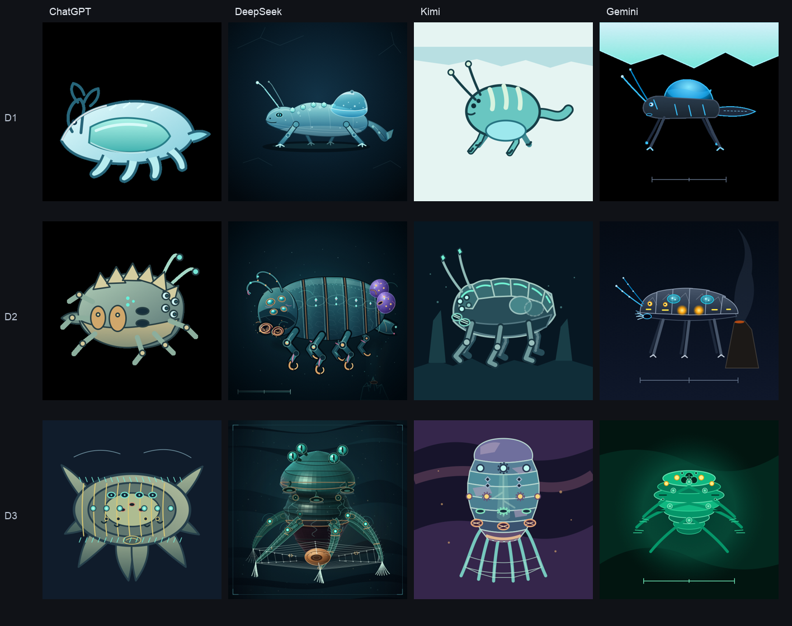
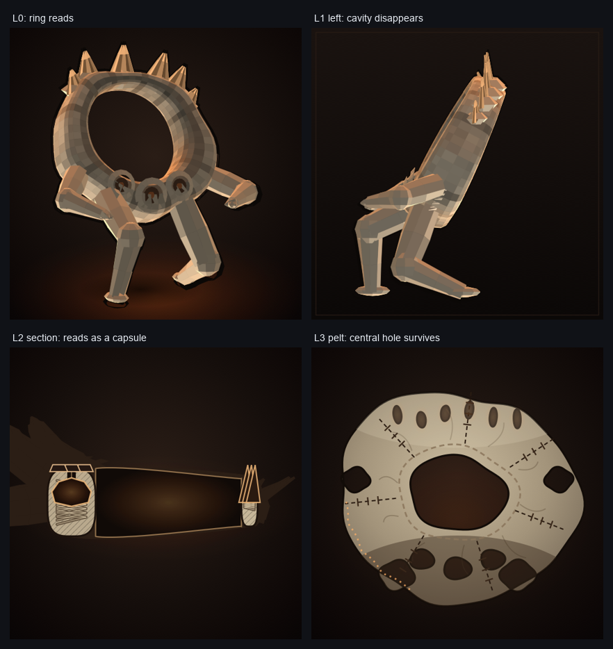
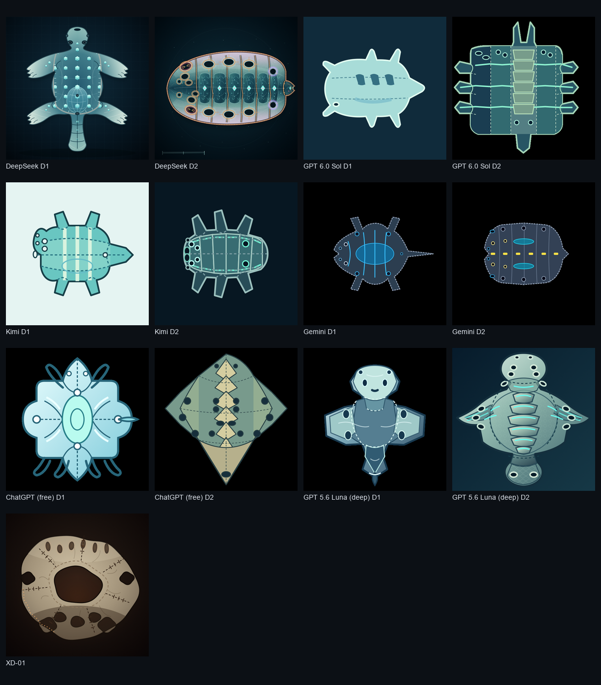
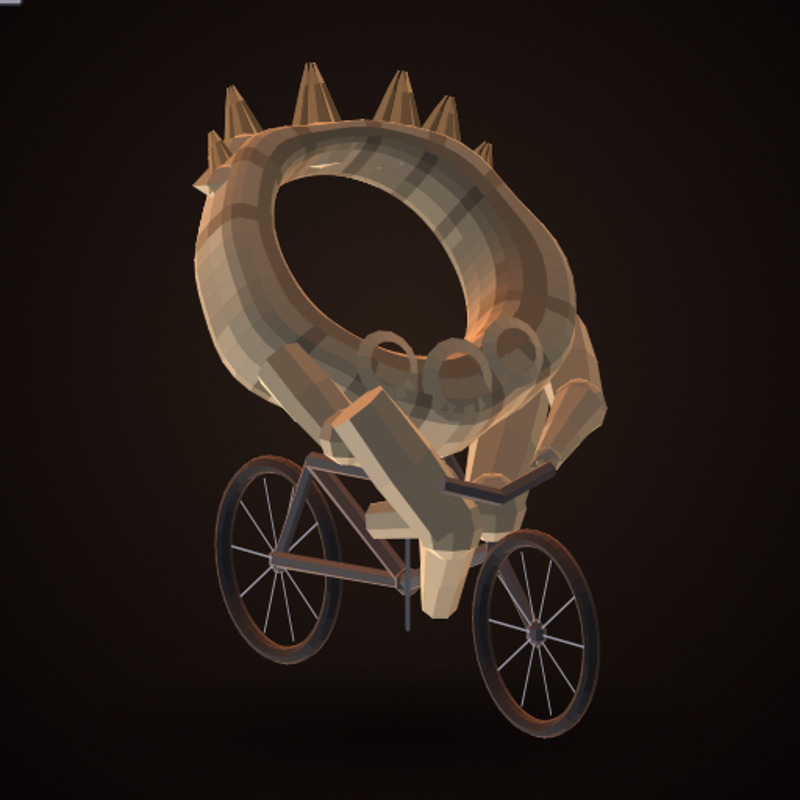
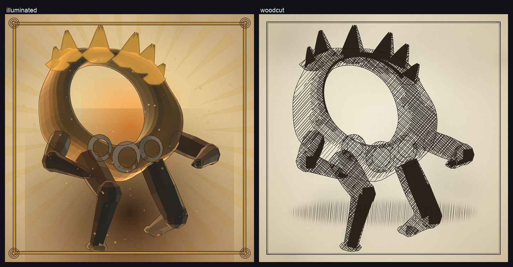
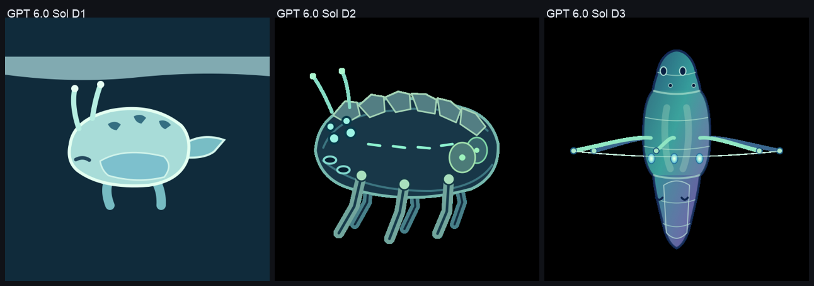
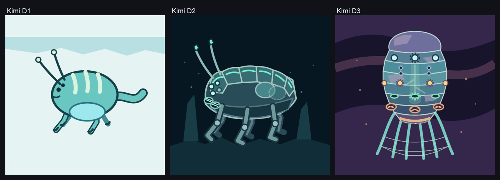
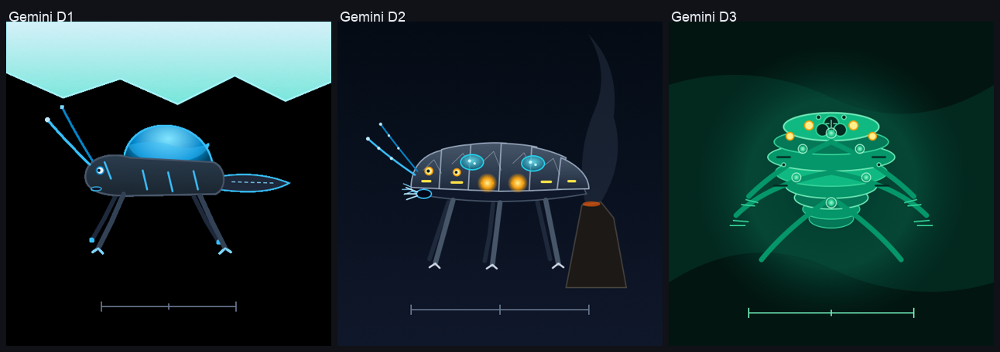

# XenoDesign — Pilot 02

**Can an AI design a coherent alien?**

Five models, three standard cards, and one D2 hard variant. 152 SVGs — portrait, six views, section, skeleton, topological pelt, motion, and the first L5 bicycle. A visual pilot, not a leaderboard.



## What's new in Pilot 02

- **GPT 6.0 Sol** ran the three standard cards (D1–D3).
- **Gemini (web)** ran the three standard cards (D1–D3).
- **Kimi K3.1 Pro** ran the three standard cards (D1–D3).
- **XD-01, the D2 hard variant**: not a fourth card — a D2 experiment with one hard geometric Q (a real through-hole whose visible area is at least 1/3 of the body silhouette). Only DeepSeek has run it so far; the failures are kept and compared.
- **First L5**: a twisted first attempt, now with an animated 3.2 s version (`ride.svg`); the original static version is archived.
- **Two style studies**: the XD-01 creature repainted as an illuminated miniature and a woodcut.
- The prompt library gains **Q-25**, a geometric-ratio Q for through-hole cavities.

## What this is

- **A pipeline test.** One set of prompts asks for a single creature carried through L0 portrait, L1 six orthographic views, L2 section, L3 skeleton + topological pelt, L4 motion, and optionally L5 ride.
- **A five-model comparison.** DeepSeek v4.1 Flash, GPT 6.0 Sol, Kimi K3.1 Pro, Gemini (web), and ChatGPT (web, free) ran the same three standard cards: 6, 13, and 20 constraints.
- **A D2 hard variant.** XD-01 stays inside D2: it adds a donut-topology constraint (one real through-hole covering at least a third of the silhouette). It is designed to break single-view plausibility.
- **A first look at the hardest part.** The L3 pelt is specified as **one continuous skin, unfolded flat** — not a cutaway, not an exploded view, not several pieces.

## What it is not

- **Not a ranking.** One run per model per card; no repeated seeds; no human scoring.
- **Not a complete matrix.** Standard D2 has no L4; D3 has only L0/L1; XD-01 has only one model; Kimi's D1 note is missing.
- **Not a claim about intelligence.** It is a visual smoke test for composition, spatial consistency, and instruction following.
- **Not a clean pass for XD-01.** The variant is deliberately hard; its failures are part of the result, not hidden.
- **Not a clean L5.** The ride is structurally distorted; the animated version moves, but the geometry still twists.
- **Counts are active submissions.** The archived static L5 is extra and is not in the 152.

## The cards

| Card | Constraints | Levels run | Note cap |
|---|---|---|---|
| **D1** | 6 | L0–L4 | 300 words |
| **D2** | 13 | L0–L3 | 600 words |
| **D3** | 20 | L0–L1 | 900 words |

The D2 card has one optional **hard variant, XD-01**: it keeps the D2 constraints but swaps Q1 for Q-25, a real through-hole cavity covering at least 1/3 of the silhouette. It is an experiment inside D2, not a fourth card.

Standard prompts: [cards/experiment-prompts.md](cards/experiment-prompts.md)  
D2 hard-variant prompt: [cards/XD-01-donut-cavity-L5.md](cards/XD-01-donut-cavity-L5.md)

## Models tested

| Model | D1 | D2 | D3 | D2-hard | Notes |
|---|---|---|---|---|---|
| DeepSeek v4.1 Flash | L0–L4 | L0–L3 | L0–L1 | L0–L5 | standard + D2 hard variant |
| GPT 6.0 Sol | L0–L4 | L0–L3 | L0–L1 | — | notes included |
| Kimi K3.1 Pro | L0–L4 | L0–L3 | L0–L1 | — | D1 note missing |
| Gemini (web) | L0–L4 | L0–L3 | L0–L1 | — | notes included; version not captured |
| ChatGPT (web, free) | L0–L4 | L0–L3 | L0–L1 | — | version not captured |

## D2 hard variant: the donut cavity

XD-01 is not a separate card; it is a hard variant of D2. It asks for one real through-hole cavity, visible area at least 1/3 of the body silhouette, with a continuous void in section and a hole/tunnel boundary in the pelt. The point is not “draw a ring”; it is to keep the same topology across portrait, six views, section, pelt, motion, and ride.

What holds:

- The L0 ring reads immediately.
- The L3 pelt keeps a central hole with seams and patterns around it.
- The L5 ride exists — the first bicycle in the project.

What breaks:

- **L1 left/right** lose the cavity and read as a solid bent slab; the six views stop describing the same object.
- **L2 section** reads as a long hollow capsule, not a cut torus; the ring topology is hard to recover.
- **The 0.39 area claim** is self-reported by the model; it is not independently measured.
- **L5 contact** is plausible but hard to verify from the drawing; the bicycle is small relative to the body.

This is why the challenge is useful: a single-view portrait can pass while the 3D object fails.



All XD-01 levels: [assets/xd01-all-levels.png](assets/xd01-all-levels.png)

## The pelt test

The pelt remains the differentiator. A good pelt is one continuous sheet with a boundary, seams, and pattern continuity — not a cutaway, not an exploded view, not several pieces. Pilot 02 adds GPT 6.0 Sol's two, Kimi's two, Gemini's two, and the XD-01 pelt with its central cavity.



## First L5: the bicycle

The optional L5 capstone is “the alien riding a bicycle” — a homage to the pelican test. XD-01 is the first submission, and it is **gloriously imperfect**:

- a complete bicycle with two wheels, frame, handlebar, saddle, and pedals;
- the ring creature is on it, with legs toward the pedals and manipulators toward the bars;
- **the body is visibly twisted/skewed** to fit the bike; it is not a clean torus in this pose;
- **the first attempt was a static SVG**; the current `ride.svg` is an **animated 3.2 s loop** with 14 `animateTransform` tracks;
- the animation fixes the staticness, but not the twist; the bicycle is small relative to the body, so the saddle/pedal/bar contact is still hard to verify.

The first version is kept as `archive/XD-01-L5/ride-static.svg`; the animated version is the current [`L5/ride.svg`](submissions/deepseek-v4.1-flash/XD-01/L5/ride.svg).

That is exactly why it is useful: the first one proves the prompt can produce a bicycle scene, and the animation proves the same scene can move. The next one can make the structure clean and the contact readable.



L5 is a capstone, not a pass/fail; a funny, specific failure is still useful.

## Style studies

The same XD-01 geometry was rendered twice: an illuminated miniature with parchment, gold line, and a hot cavity; and a woodcut built from hatched lines. The geometry is shared; only the rendering changes.



## First observations

1. **All 152 SVGs are structurally valid.** 152/152 parse, use `viewBox="0 0 512 512"`, and contain no `<text>`, `<image>`, `<script>`, `foreignObject`, or external `href`. The largest file is 363 KB, under the 512 KB cap.
2. **The pelt is still the differentiator.** DeepSeek, GPT 6.0 Sol, Kimi, and Gemini read more like one continuous skin; ChatGPT's D1/D2 pelts are single sheets but read more like symmetrical patterns. The XD-01 pelt is the clearest topological test because the central hole has to survive the unfold.
3. **Kimi is strongest at D2/D3; its D1 is much simpler and has no design note.** D1 is a clean, friendly creature, but without a note the six constraints cannot be checked line by line. D2 and D3 have detailed notes and much denser constraint mapping. The gap is useful: a model can produce a clean picture without showing the reasoning.
4. **GPT 6.0 Sol is the cleanest vector stylist of the five.** D1 is a tiny fish-like ice creature, D2 a vent-orb, D3 a 24 m cyst-weaver. D1/D2 include pelt and section; D3 stops at L0/L1. Its D1 uses only two walking limbs, which is allowed by “≤4” — don't misread it as a missing limb.
5. **Gemini is the most literal note-taker of the five.** Its cards come with scale bars and a full constraint map; D1 is a fish-like ice creature with a dorsal water sac, D2 a vent beetle, D3 a green radial organism. D1/D2 include pelt and section; D3 stops at L0/L1. The notes are systematic; the pictures are flatter and more diagram-like than Kimi's.
6. **XD-01 shows the single-view trap.** The L0 ring and the L5 bicycle are convincing at a glance; the L1 side views and L2 section are where the topology falls apart. The notes claim a 0.39 area ratio and a continuous void; the artifacts do not fully prove either.
7. **The first L5 now moves.** `ride.svg` is a 3.2 s animated loop; the body is still visibly twisted, and the contact/balance need a frame-by-frame check. The static first attempt is kept in `archive/XD-01-L5/`.
8. **Style studies are cheap and high-leverage.** Re-rendering the same geometry in two historical styles adds a second axis — representation — without changing the design constraints.







## The standard

Pilot 02 is the second run of a small open standard:

- [Main standard](spec/异星生物设计_主标准.md) — P/F/Q/N constraints, D1–D3, L0–L5, checks.
- [Prompt authoring guide](spec/提示词撰写指南.md) — raw requirement words → complete prompt.
- [Prompt library](spec/提示词素材库.md) — 7 P / 26 F / 25 Q / 10 N / 6 bonus badges, plus Q-25 for through-hole geometry.
- [L0 template](spec/L0_通用提示词模板.md) — a copy-paste prompt a blank model can execute.

The documents are Chinese-first for now; the prompts themselves are English so they work with any model.

## Build your own card

The three standard cards are examples, not the whole standard. The kit is:

- **Prompt library** — the parts: 7 P, 26 F, 25 Q, 10 N, 6 bonus badges, plus a Tension library.
- **Prompt authoring guide** — the compiler: turns raw requirement words into a complete prompt.
- **L0 template** — the output skeleton.

A simple workflow:

1. **Pick parts** from the library, or write your own words. Target loads:

| Difficulty | P | F | Q | N |
|---|---|---|---|---|
| D1 | 1 | 2 | 3 | 0 |
| D2 | 2 | 4 | 6 | 1 |
| D3 | 3 | 6 | 9 | 2 |

2. **Add your own words if you want.** The library is a menu, not a closed list. Write a new P/F/Q/N item in the same format, give it a new ID at the end, and say what visual evidence a reviewer should look for. Do not renumber existing IDs.
3. **Compile it** with the meta-prompt in the authoring guide. It classifies each word, normalizes vague wording, checks conflicts/tensions, sets the difficulty and note cap, and writes the complete prompt.
4. **Run and submit**: save the SVGs under `submissions/<model>/<card>/<level>/`, save the note, run `python3 build_gallery.py`, and open a PR.

**You are not limited to the library.** The library gives you parts; the guide turns parts into a prompt; your own words are allowed as long as they are visible, countable, or checkable.

## Call for submissions

This pilot is deliberately unfinished.

- **More models.** Any model, open or closed, local or hosted. The XD-01 challenge is especially open — it currently has only one model.
- **More styles and media.** SVG is the reference format because it renders and diffs cleanly, but the design logic is the point. Raster, pixel art, 3D, ASCII, video, or another medium is welcome under [`submissions/experimental/`](submissions/experimental/README.md); say what you changed.
- **L5: the bicycle is moving.** The first one now has an animated 3.2 s loop — still twisted, still imperfect, but it moves. We want the next one to be structurally clean, contact-readable, and unmistakably riding. Different creature, different bike, different failure: all welcome.
- **More hard variants.** Q-25 is the first geometric-ratio Q. If you have another topology test — a handle, a second tunnel, a non-orientable surface — propose it as a D2/D3 variant, not a new card.

中文：第一个 L5 已经有动图版了——结构仍然扭曲，但它真的骑着车动了起来。更期待下一个：结构干净、接触正确、真的像在骑的“外星人骑自行车”。

## Files

```text
.
├── README.md
├── index.html                 # generated gallery
├── build_gallery.py
├── data.json
├── assets/                    # hero, pelt, L1, section/skeleton, motion, XD-01
├── cards/
│   ├── experiment-prompts.md  # D1/D2/D3
│   └── XD-01-donut-cavity-L5.md
├── submissions/
│   ├── deepseek-v4.1-flash/   # D1–D3 + D2 hard variant XD-01
│   ├── gpt-6.0-sol/           # D1–D3
│   ├── kimi-k3.1-pro/         # D1–D3
│   ├── gemini-web/            # D1–D3
│   ├── chatgpt-web/           # D1–D3 (free web)
│   └── experimental/          # non-SVG media
├── archive/                   # first static L5, kept for comparison
├── reports/
│   ├── pilot-01.md
│   ├── pilot-02.md
│   ├── release-v0.1-pilot.md
│   ├── release-v0.2-pilot.md
│   └── release-v0.3-pilot.md
├── spec/                      # standard, guide, library (25 Q), template
├── LICENSE
├── LICENSE-CONTENT
├── CONTRIBUTING.md
└── .gitignore
```

## Core files, by job

| Path | What it is | Who it's for |
|---|---|---|
| `README.md` | Landing page: what this is, the cards, the challenge, how to build a card. | Everyone |
| `index.html` | Static gallery; GitHub Pages serves it. | Visitors |
| `assets/` | Rendered comparison sheets, including the 5×3 L0 grid, 11-pelt comparison, and XD-01 failure sheet. | README and gallery |
| `cards/` | The standard prompts and the XD-01 challenge. | People running a model |
| `submissions/` | 152 SVGs and the design notes, grouped by model/card/level. | Contributors and reviewers |
| `spec/` | Main standard, authoring guide, prompt library, L0 template. | People building new cards |
| `build_gallery.py` | Rebuilds `index.html`; stdlib only. | Maintainers |
| `data.json` | Model, card, level, and count metadata. | Maintainers |
| `archive/XD-01-L5/` | The first static L5 attempt, kept for comparison; not indexed by the gallery. | Readers |
| `reports/pilot-01.md` | Pilot 01 observations. | Readers |
| `reports/pilot-02.md` | Pilot 02 observations: Kimi, XD-01, L5, style studies. | Readers |
| `reports/release-v0.1-pilot.md` | Release note for `v0.1-pilot`. | Maintainers |
| `reports/release-v0.2-pilot.md` | Release note and asset list for `v0.2-pilot`. | Maintainers |
| `reports/release-v0.3-pilot.md` | Release note and asset list for `v0.3-pilot`. | Maintainers |
| `LICENSE` / `LICENSE-CONTENT` | MIT for code; CC BY 4.0 for prompts/docs/gallery images. | Everyone |
| `CONTRIBUTING.md` | How to add a model run, a vocabulary item, or an experimental medium. | Contributors |
| `.gitignore` | Keeps `.DS_Store`, caches, and `.env` out of the repo. | Maintainers |

## Release

Pilot 01 is tagged `v0.1-pilot`. Pilot 02 is published as `v0.2-pilot` (4-model snapshot, 124 SVGs) and `v0.3-pilot` (5-model snapshot, 152 SVGs). v0.3 used the old “challenge” label; the living gallery now treats XD-01 as a D2 hard variant. Release notes: [v0.3](reports/release-v0.3-pilot.md) · [v0.2](reports/release-v0.2-pilot.md).

## License

- Code and scripts: **MIT** — [LICENSE](LICENSE)
- Prompts, cards, documentation, and gallery images: **CC BY 4.0** — [LICENSE-CONTENT](LICENSE-CONTENT)
- Model outputs may also be subject to the providers' terms.

## Status

Pilot 02. Five models, 152 SVGs, one D2 hard variant, one L5. Still one sample per model/card, no repeats, no formal K1–K8 / M1–M7 scoring, and no blind human check. The XD-01 failures are intentionally visible.

Next: formalize the K/M checklists, run 3 seeds per model/card, add a blind human check on L0, turn the animated L5 into a clean, contact-readable ride, and invite more models to XD-01.

Detailed notes: [reports/pilot-02.md](reports/pilot-02.md) · Gallery: [index.html](index.html)
