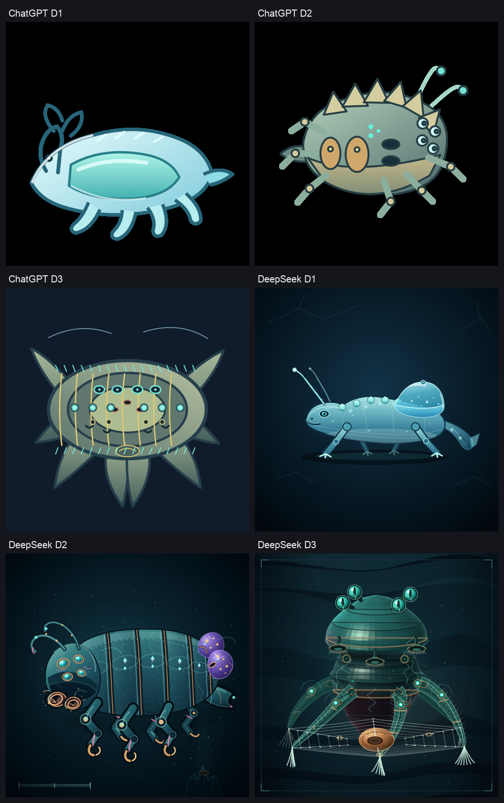
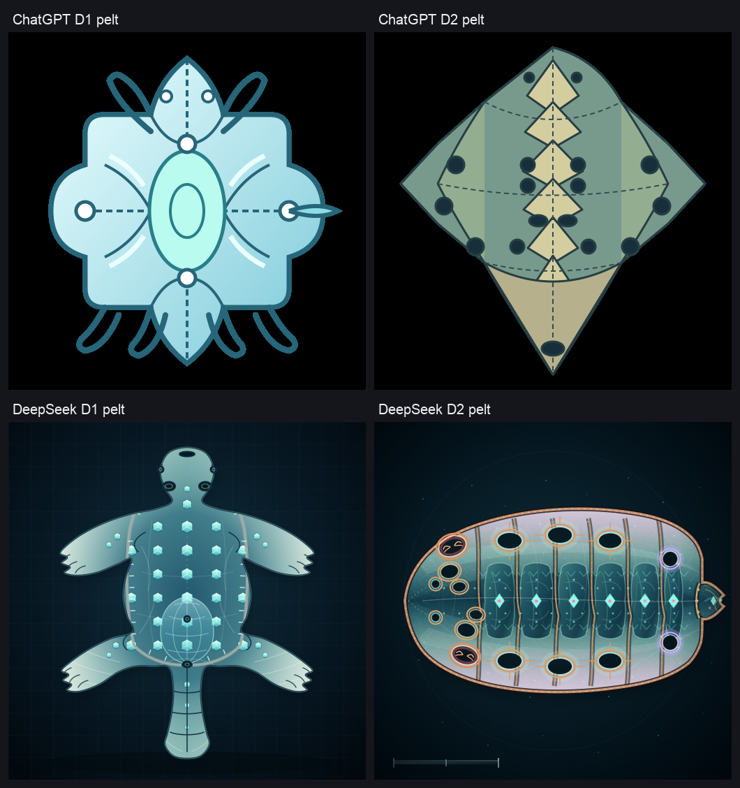
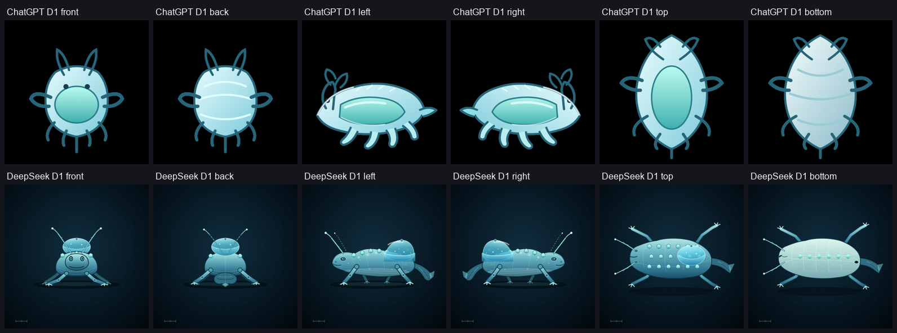

# XenoDesign — Pilot 01

**Can an AI design a coherent alien?**

Two models, three constraint cards, up to five view levels. This is the first visual pilot of the XenoDesign standard — a pipeline test and a gallery, not a leaderboard.



## What this is

- **A pipeline test.** One set of prompts asks for a single creature carried through L0 portrait, L1 six orthographic views, L2 section, L3 skeleton + topological pelt, and L4 motion.
- **A paired visual comparison.** ChatGPT (web) and DeepSeek v4.1 Flash ran the same three cards: 6, 13, and 20 constraints.
- **A first look at the hardest part.** The L3 pelt is specified as **one continuous skin, unfolded flat** — not a cutaway, not an exploded view, not several pieces.

## What it is not

- **Not a ranking.** One run per model per card; no repeated seeds; no human scoring.
- **Not a complete run.** D2 has no L4; D3 has only L0/L1; the ChatGPT web model version was not captured.
- **Not a claim about intelligence.** It is a visual smoke test for composition, spatial consistency, and instruction following.

## The cards

| Card | Constraints | Levels run | Note cap |
|---|---|---|---|
| **D1** | 6 | L0–L4 | 300 words |
| **D2** | 13 | L0–L3 | 600 words |
| **D3** | 20 | L0–L1 | 900 words |

Full prompts: [cards/experiment-prompts.md](cards/experiment-prompts.md)

## The standard

The pilot is the first run of a small open standard:

- [Main standard](spec/异星生物设计_主标准.md) — P/F/Q/N constraints, D1–D3, L0–L5, checks.
- [Prompt authoring guide](spec/提示词撰写指南.md) — raw requirement words → complete prompt.
- [Prompt library](spec/提示词素材库.md) — 7 P / 26 F / 24 Q / 10 N / 6 bonus badges.
- [L0 template](spec/L0_通用提示词模板.md) — a copy-paste prompt a blank model can execute.

The documents are Chinese-first for now; the prompts themselves are English so they work with any model.

## Build your own card

The three pilot cards are examples, not the whole standard. The kit is:

- **Prompt library** — the parts: 7 P, 26 F, 24 Q, 10 N, 6 bonus badges, plus a Tension library.
- **Prompt authoring guide** — the compiler: turns raw requirement words into a complete prompt.
- **L0 template** — the output skeleton.

A simple workflow:

1. **Pick parts** from the library, or write your own words. Target loads:

| Difficulty | P | F | Q | N |
|---|---|---|---|---|
| D1 | 1 | 2 | 3 | 0 |
| D2 | 2 | 4 | 6 | 1 |
| D3 | 3 | 6 | 9 | 2 |

2. **Add your own words if you want.** The library is a menu, not a closed list. Write a new P/F/Q/N item in the same format, give it a new ID at the end, and say what visual evidence a reviewer should look for. Do not renumber existing IDs.
3. **Compile it** with the meta-prompt in the authoring guide. It classifies each word, normalizes vague wording, checks conflicts/tensions, sets the difficulty and note cap, and writes the complete prompt.
4. **Run and submit**: save the SVGs under `submissions/<model>/<card>/<level>/`, save the note, run `python3 build_gallery.py`, and open a PR.

**You are not limited to the library.** The library gives you parts; the guide turns parts into a prompt; your own words are allowed as long as they are visible, countable, or checkable.

## Call for submissions

This pilot is deliberately unfinished.

- **More models.** Any model, open or closed, local or hosted.
- **More styles and media.** SVG is the reference format because it renders and diffs cleanly, but the design logic is the point. Raster, pixel art, 3D, ASCII, video, or another medium is welcome under [`submissions/experimental/`](submissions/experimental/README.md); say what you changed.
- **L5 wanted.** The alien riding a bicycle is still unclaimed. If your model can do it, add `submissions/<model>/<card>/L5/ride.svg` and a note. The L5 prompt is in the standard.

欢迎更多模型、更多风格、更多媒介来试这套题；也期待第一个 L5“外星人骑自行车”的提交。

## First observations

1. **All 56 SVGs are structurally valid.** 56/56 parse, use `viewBox="0 0 512 512"`, and contain no `<text>`, `<image>`, `<script>`, or external assets. The largest file is 362 KB, under the 512 KB cap.

2. **The pelt is the differentiator.** DeepSeek's D1/D2 pelts read as one continuous skin with a head, limb sleeves, tail, seam, and pattern. ChatGPT's D1/D2 pelts are also single sheets, but read more like symmetrical patterns. This is the artifact to review with the K1–K8 checks.

3. **The six views mostly hold together.** DeepSeek's L1 sets are more detailed. ChatGPT's D1 note explicitly says the water sac is hidden in back/top/bottom and visible in front/side, which matches the images; the occlusion is accounted for, not silently dropped.

4. **L4 is not equally solved.** ChatGPT D1 has two animation tracks (body bob + leg rotation, 3.6 s); DeepSeek D1 has fourteen tracks (body and limb motion, 3.2 s). Both loop, but neither is verified as a full run/jump. ChatGPT's note claims contact and anticipation that are hard to see in the two-track SVG.

5. **The notes are part of the result.** Across the set, both models produced constraint-to-feature mappings, hidden-feature notes, and `RECONCILE` / `CONFLICT` lines. DeepSeek's D3 note even explains why 6-fold, 4-fold, and 3-fold rings cannot share an exact symmetry group while keeping radial symmetry as a body plan.

## The pelt test



What the L3 prompt asks for:

- **One continuous piece**, unfolded flat, like a tiger pelt stretched on the ground;
- the **full outer surface**, seam/incision lines, and pattern continuity;
- every opening, eye, limb socket (or sleeve), and tail base as a **hole, boundary, or extension**;
- dorsal / ventral / left / right layout;
- explicitly **not** a cutaway, **not** an exploded view, **not** multiple pieces.

DeepSeek D1/D2 show the intended read. ChatGPT D1/D2 pass the "single sheet, not a cutaway" bar but are weaker as pelts; the formal K4/K5/K7 review is the next step.

## Six views



## Files

```text
xenodesign-pilot-01/
├── README.md                 # this page
├── index.html                # static gallery (open locally)
├── build_gallery.py          # regenerates index.html, stdlib only
├── data.json                 # model/card metadata
├── assets/                   # rendered comparison sheets
├── cards/
│   └── experiment-prompts.md # the three prompts
├── submissions/
│   ├── chatgpt-web/
│   │   ├── D1/  # L0–L4 + DESIGN_NOTES.md
│   │   ├── D2/  # L0–L3 + README_设计说明.txt
│   │   └── D3/  # L0–L1 + level notes
│   ├── deepseek-v4.1-flash/
│   │   ├── D1/  # L0–L4 + design-notes.md
│   │   ├── D2/  # L0–L3 + xenodesign.md
│   │   └── D3/  # L0–L1 + L0.md / L1.md
│   └── experimental/         # non-SVG media (see its README)
├── reports/
│   ├── pilot-01.md           # detailed Chinese observations
│   └── release-v0.1-pilot.md # release-note draft
├── spec/                     # the standard, guide, library, template
├── LICENSE                   # MIT (code and scripts)
├── LICENSE-CONTENT           # CC BY 4.0 (prompts, docs, gallery images)
├── CONTRIBUTING.md
└── .gitignore
```

## Core files, by job

| Path | What it is | Who it's for |
|---|---|---|
| `README.md` | The landing page: what this is, the cards, the pelt test, how to build your own card. | Everyone |
| `index.html` | The static gallery; GitHub Pages serves it. | Visitors |
| `assets/` | Rendered comparison sheets: L0 grid, pelts, six views, sections/skeletons, motion. | README and gallery |
| `cards/experiment-prompts.md` | The three cards used in Pilot 01. | People running a model |
| `submissions/` | The 56 SVGs and the design notes, grouped by model/card/level. | Contributors and reviewers |
| `spec/` | The main standard, authoring guide, prompt library, and L0 template. | People building new cards |
| `build_gallery.py` | Rebuilds `index.html` after new submissions; stdlib only. | Maintainers |
| `data.json` | Model, card, level, and note-cap metadata. | Maintainers |
| `reports/pilot-01.md` | Detailed Chinese observations and caveats. | Readers |
| `reports/release-v0.1-pilot.md` | Draft release note for `v0.1-pilot`. | Maintainers |
| `LICENSE` / `LICENSE-CONTENT` | MIT for code; CC BY 4.0 for prompts/docs/gallery images. | Everyone |
| `CONTRIBUTING.md` | How to add a model run or a new vocabulary item. | Contributors |
| `.gitignore` | Keeps `.DS_Store`, caches, and `.env` out of the repo. | Maintainers |

## Release

Draft notes for `v0.1-pilot`: [reports/release-v0.1-pilot.md](reports/release-v0.1-pilot.md).

## Reproduce

1. Open [cards/experiment-prompts.md](cards/experiment-prompts.md) and pick a card.
2. Paste it into a model; save the SVGs into `submissions/<model>/<card>/<level>/`.
3. Save the design note next to the card or level.
4. Run `python3 build_gallery.py` and open `index.html`.

No server, no dependencies, no build step beyond the stdlib script.

## Contributing

Add a model run under `submissions/`, run `python3 build_gallery.py`, and open a pull request. See [CONTRIBUTING.md](CONTRIBUTING.md) for the folder layout and rules.

## License

- Code and scripts: **MIT** — [LICENSE](LICENSE)
- Prompts, cards, documentation, and gallery images: **CC BY 4.0** — [LICENSE-CONTENT](LICENSE-CONTENT)
- Model outputs may also be subject to the providers' terms.

## Status

Pilot only. This is the first evidence that the prompt chain can produce the full L0–L4 artifact set, and that the L3 pelt is a useful visual differentiator. It is not yet a benchmark result: one sample per model/card, no repeats, no formal K1–K8 / M1–M7 scoring, and the ChatGPT model version is unknown.

Next: formalize the K/M checklists, run 3 seeds per model/card, add a blind human check on the L0 images, and complete the missing L4/L2–L4 combinations.

Detailed notes: [reports/pilot-01.md](reports/pilot-01.md) · Gallery: [index.html](index.html)
