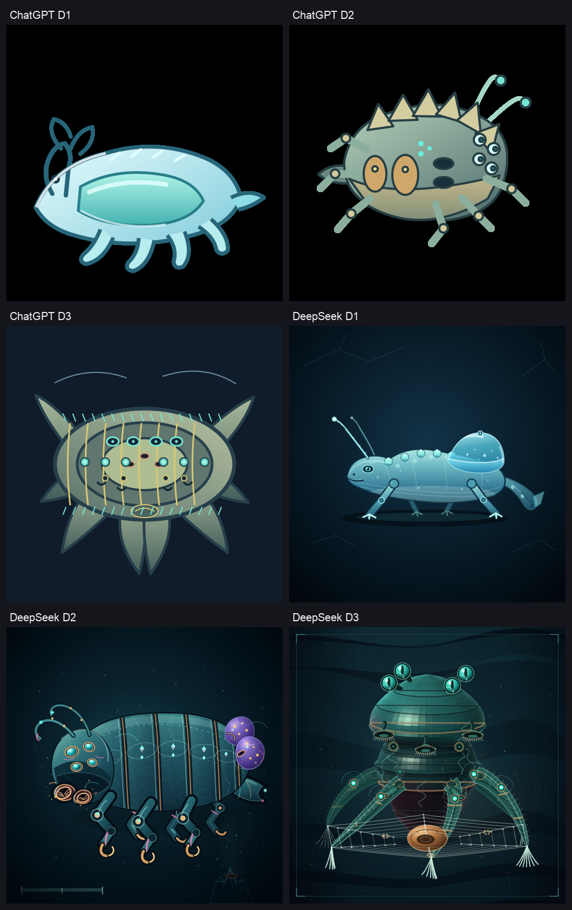
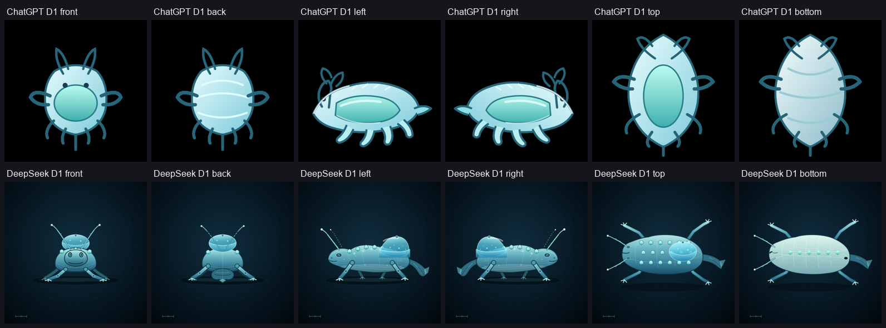
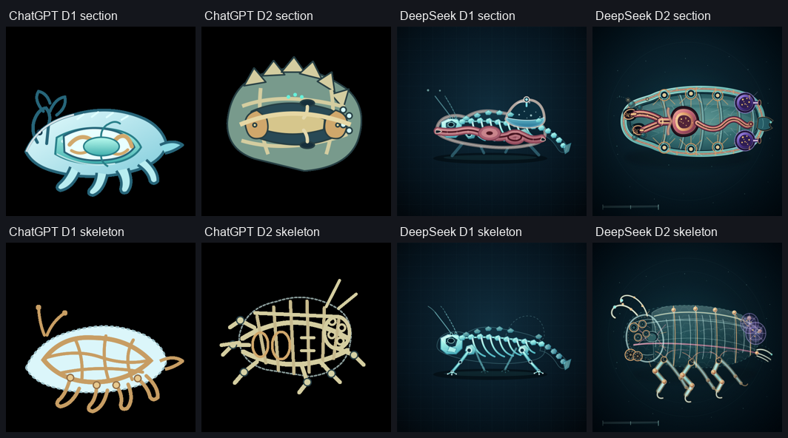
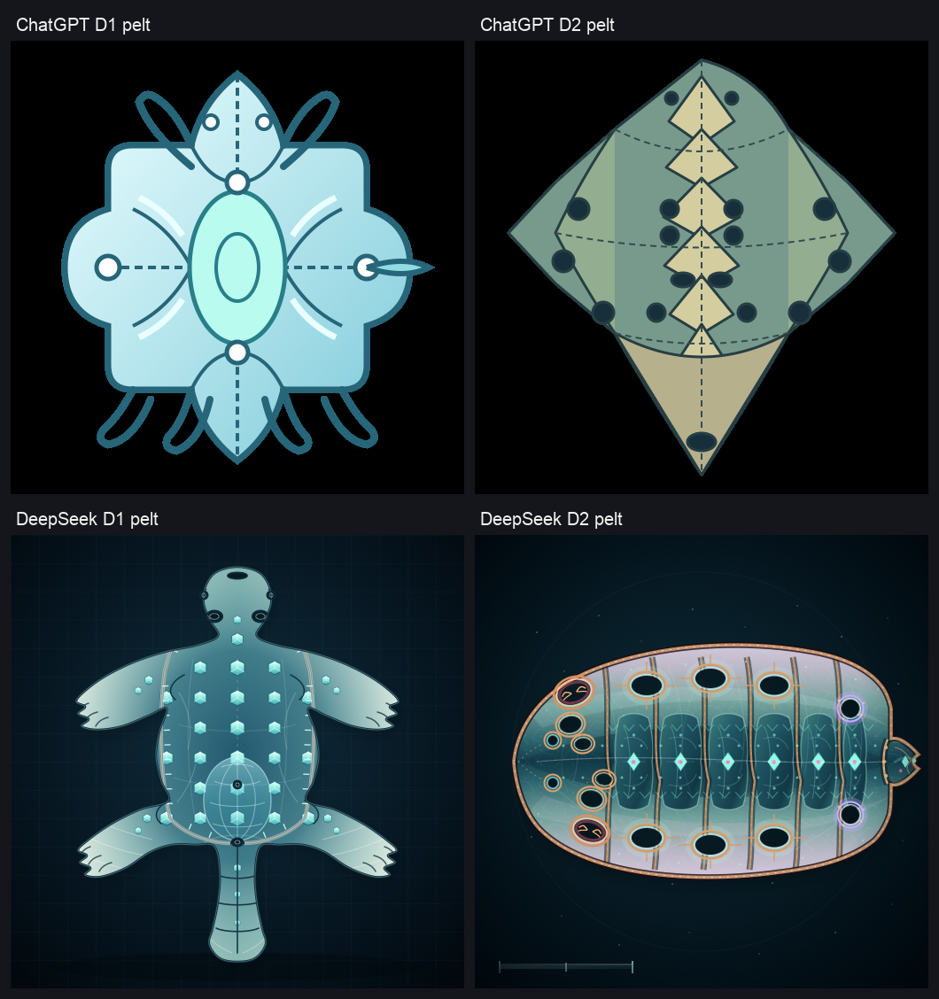
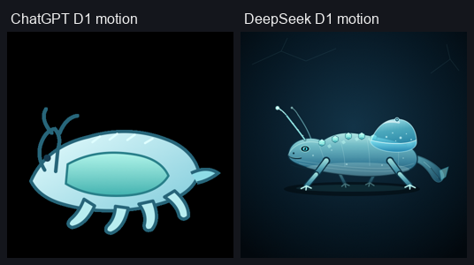

# Pilot 01 观察报告

> 日期：2026-11-13
> 范围：ChatGPT（网页版）× 3 张卡，DeepSeek v4.1 Flash × 3 张卡；共 56 个 SVG。
> 结论：**可以初步写成一份项目/pilot，但还不能当成 benchmark 结果。**

---

## 0. 先说结论

**能写成什么：**

- 6 个 run：2 个模型 × 3 张难度卡；
- 56 个 SVG：L0 6 个、L1 36 个（6 视图 × 6 组）、L2 4 个、L3 8 个（4 骨架 + 4 皮张）、L4 2 个；
- 6 组设计说明（card-level 或 level-level），而且不是敷衍的——有约束映射、遮挡声明、`RECONCILE`，DeepSeek D3 还有 `CONFLICT`；
- 一条完整的 L0–L4 链路（D1），以及 L0–L3（D2）、L0–L1（D3）。

**不能写成什么：**

- 不能写成“DeepSeek 比 ChatGPT 强”的排名：n=1，没有重复采样；
- 不能写成“通过/不通过”的正式评测：K1–K8 / M1–M7 还没有逐项填；
- 不能忽略 ChatGPT 的版本没有记录；
- 不能把 D1/D2/D3 互相比较：它们是三张不同的卡。

**最值得展示的资产：L3 皮张对比。**  
**最值得警惕的发现：ChatGPT D1 的 L4 说明比它的动画“说得更多”。**

---

## 1. 实验设置

| 模型 | 卡 | 约束数 | 实际跑到的层级 | 注释上限 |
|---|---|---|---|---|
| ChatGPT（网页版，版本未记录） | D1 | 6 | L0–L4 | 300 词 |
| ChatGPT（网页版，版本未记录） | D2 | 13 | L0–L3 | 600 词 |
| ChatGPT（网页版，版本未记录） | D3 | 20 | L0–L1 | 900 词 |
| DeepSeek v4.1 Flash | D1 | 6 | L0–L4 | 300 词 |
| DeepSeek v4.1 Flash | D2 | 13 | L0–L3 | 600 词 |
| DeepSeek v4.1 Flash | D3 | 20 | L0–L1 | 900 词 |

三张卡的完整提示词在 `cards/experiment-prompts.md`。

**重要限制**：D1/D2/D3 是三张不同的卡，不是同一张卡的三次重复。模型之间的比较只发生在“同一张卡、同一个层级”内；跨卡比较没有意义。

---

## 2. 结构扫描

| 项 | 结果 |
|---|---|
| SVG 总数 | 56 |
| XML 解析 | 56/56 通过 |
| `viewBox="0 0 512 512"` | 56/56 |
| `<text>` | 0 |
| `<image>` / `<script>` / `<foreignObject>` | 0 |
| 外部资源 | 0（`xmlns` 的 http 不算外链） |
| 最大文件 | DeepSeek D3 L0，362,723 B，低于 512 KB |
| L4 动画 | ChatGPT D1：2 条 animation，3.6 s；DeepSeek D1：14 条，3.2 s |
| 8–12 帧降级 | 两组 D1 都没有用，均交了 `motion.svg` |

**结论**：这批输出在“结构合规”上是干净的；问题不在 SVG 合法性，而在“图是否真的对得上说明和约束”。

---

## 3. 分层观察

### 3.1 L0：六张图，差距已经很明显

- **ChatGPT D1**：最简单的一张，像一个带腿的扁水袋；能看出“水囊”和“冰蓝壳”，但细节少，肢体和触角都偏符号化。
- **ChatGPT D2**：一只甲虫状生物，有 6 肢、4 眼、背刺、触角；比 D1 完整，但仍偏“卡通虫”。
- **ChatGPT D3**：放射状生物，环形排列的眼/肢/板；概念对，但层次偏平。
- **DeepSeek D1**：明确的冰下甲虫，触角、4 肢、尾、背囊、比例尺都有；完成度最高。
- **DeepSeek D2**：分节甲壳 + 6 肢 + 4 眼 + 6 背板 + 2 孢子囊；细节和材质明显更丰富。
- **DeepSeek D3**：大型放射状“钟形”生物，6 肢、4 眼、3 口、8 节；视觉最复杂，但也最难逐项核对。

### 3.2 L1：六视图

- **DeepSeek D1**：六个方向的比例、肢体、背囊位置基本能对上；顶/底视图做了简化，但能解释。
- **ChatGPT D1**：前/后视图偏“圆脸”，侧视图偏“长身体”；它的说明明确写了“水囊在 front/left/right 可见，在 back/top/bottom 被壳遮住”，图像和这句话基本对得上。**不要把“前视图看不到背囊”直接当成错误**——这是遮挡，不是消失。
- 两组的顶/底视图都偏简化；L1 的形式合规，但“六视图是否真的同一只”还需要逐项数量检查。
- **观察**：DeepSeek 的六视图更像同一套 3D 资产的正交投影；ChatGPT 的更像“围绕同一个概念画的六张图”。

### 3.3 L2：剖面

- ChatGPT D1/D2 的剖面能看出“外轮廓 + 内部腔体”，但内部结构偏简单；
- DeepSeek D1/D2 的剖面有明确的消化道、腔体、材质分层，细节明显更多；
- 四张都符合“剖切/剖面”的形式，没有画成外部图；
- 但没有逐项核对“所有开口是否都连到腔体”，这项要等 S1–S5 正式检查。

### 3.4 L3：骨架 + 拓扑皮张（本项目最关键的差异）

**DeepSeek D1/D2：**

- 一张连续皮，能看出头部、四肢袖口、尾根、背/腹分区；
- D1 有明显的腹侧切口、四肢套筒、背中线花纹；
- D2 是分节皮张，左右侧翼、背中带、孔洞和接缝都能对上说明；
- 视觉上就是“把皮剥下来摊平”，不是剖面，也不是爆炸图。

**ChatGPT D1/D2：**

- 都是“一张连续片”，不是多块拼贴，也没有画成剖面/爆炸图；
- 但 D1 更像一个对称的装饰图案（四瓣 + 中心椭圆），D2 像一个菱形纹样；
- 它们的说明都声称有眼/口/肢/触角的孔位，但图上这些孔位是否真的能一一对应，需要 K5/K7 的人工核对；
- 目前只能说：**形式合规，读感偏弱**，不能直接判“错”。

**骨架**：

- DeepSeek 的骨架与外形对齐更好，关节/肢体/开口支撑更清楚；
- ChatGPT D1 的骨架偏简单，D2 的骨架像网格，支撑关系弱一些。

**结论**：L3 皮张是这套题目前最强的“视觉差异器”。它能把“会画外形”和“真的想过展开”分开；但必须用 K1–K8 逐项检查，不能只凭“好不好看”。

### 3.5 L4：动画

- **ChatGPT D1**：`motion.svg` 只有 2 条 animation——身体上下位移 + 腿部旋转，3.6 s 循环。它能动，但更像“原地弹跳/摆动”，不是完整的 run/jump。
- **DeepSeek D1**：14 条 animation——身体 rx、四肢旋转、位移等，3.2 s 循环；更像一个步态循环，但也没有逐帧验证“脚是否打滑、是否有预备/落地”。
- ChatGPT D1 的说明写了“feet plant during the push phase, body compresses in anticipation and settles with follow-through”；但 2 条 animation 很难支撑这句话。**这是“说明比 artifact 说得更多”的典型例子。**
- 两组都没有用 8–12 帧降级；都交了 `motion.svg`，这点合规。
- L4 目前只能判“有动画”，不能判“完整跑跳”。

### 3.6 D3：只有 L0/L1，但说明很有价值

- ChatGPT D3 的 L0/L1 说明有 `RECONCILE`，解释了 6 肢/6 发光器按 60°、4 眼/4 感觉凹点按 90°、3 体区与 8 体节的关系；
- DeepSeek D3 的说明更进一步，有 `CONFLICT`：6-fold、4-fold、3-fold 环不能共享同一个精确对称群，所以保留“放射身体规划”，让 Q 计数优先于精确对称；
- 这说明“同级别冲突/张力”的协议不是纸上谈兵，模型确实会写；
- 但 D3 没有 L2/L3/L4，无法验证这些说明是否被剖面/骨骼/动画支撑。

---

## 4. 首轮印象表

> **这不是正式评分。** 只是“看完图 + 说明”的第一印象；✅/⚠️/— 不代表 K/M 检查通过。

| 模型 | 卡 | L0 | L1 | L2 | L3 骨架 | L3 皮张 | L4 |
|---|---|---|---|---|---|---|---|
| ChatGPT | D1 | ⚠️ | ⚠️ | ⚠️ | ⚠️ | ⚠️ | ⚠️ |
| DeepSeek | D1 | ✅ | ✅ | ✅ | ✅ | ✅ | ⚠️ |
| ChatGPT | D2 | ⚠️ | ⚠️ | ⚠️ | ⚠️ | ⚠️ | — |
| DeepSeek | D2 | ✅ | ✅ | ✅ | ✅ | ✅ | — |
| ChatGPT | D3 | ⚠️ | ⚠️ | — | — | — | — |
| DeepSeek | D3 | ✅ | ⚠️ | — | — | — | — |

**怎么读：**

- ✅ = 第一眼能看出约束、结构基本成立；
- ⚠️ = 有东西，但细节/一致性/说明与图的对齐需要正式检查；
- — = 没跑。
- 没有 ❌，因为还没有做正式 K/M 检查；不要把这个表当结论。

---

## 5. 说明 vs artifact：最值得写进项目的一点

这批数据最有价值的，不是“谁画得好看”，而是**说明和图能不能对上**。

### 5.1 ChatGPT D1 L4：说明比动画多

说明写的是完整步态：脚着地、身体压缩、跟随；实际 SVG 只有 2 条 animation。  
这不是“模型撒谎”，而是**文字说明可以轻松描述一个它没有真正做出来的动态**。  
项目必须把“说明里的 claims”逐条对照 artifact，否则会被文字骗过去。

### 5.2 ChatGPT D1/D2 皮张：说明声称的孔位需要核对

说明都列了“眼/口/肢/触角/尾根”的孔位；图上确实有圆孔/凹口，但是否一一对应，需要 K5/K7 人工核对。  
**这正是 L3 检查表存在的意义**：不是看“像不像皮”，而是看“孔位数量、接缝、花纹、背腹布局是否对得上”。

### 5.3 DeepSeek D2：说明和图最一致

DeepSeek D2 的 `xenodesign.md` 把 L0/L1/L2/L3 全部写在一份说明里，皮张的“左半 = 左翼、右半 = 右翼、中带 = 背、外缘 = 腹”与图像能对上。  
这是目前最强的一份“设计说明书 + artifact”组合。

### 5.4 D3：冲突协议被真正使用

DeepSeek D3 的 `CONFLICT` 行不是套话，它解释了 6/4/3 重环的对称性矛盾，并明确“Q 计数优先于精确对称”。  
ChatGPT D3 的 `RECONCILE` 也解释了 60°/90° 环和 3 体区/8 体节。  
这说明“同级别冲突/张力”的协议是可执行的，不只是文档里的概念。

---

## 6. 它证明了什么 / 没证明什么

### 证明了

- 这套 prompt 能产出 L0–L4 的完整 artifact 链（D1）；
- SVG 规则在结构上被遵守：viewBox、无 text、无外链、无位图；
- L3 皮张 prompt 能产生明显的模型差异，且差异是“空间展开”的差异，不只是画风；
- 模型能写约束映射、遮挡声明、`RECONCILE`/`CONFLICT`；
- 这件事有视觉传播力：同一张卡、两个模型、皮张对比，已经能讲一个故事。

### 没证明

- 不能排名：n=1，没有重复，没有 seed 控制；
- 不能判“通过/不通过”：K1–K8、M1–M7 还没逐项填；
- 不能忽略 ChatGPT 版本未记录；
- 不能证明 L4 是完整跑跳：ChatGPT 只有 2 条 animation；DeepSeek 也没有逐帧验证；
- 不能证明 D3 的说明被内部结构支撑：D3 只有 L0/L1；
- 不能证明跨 seed 稳定：只跑了一次。

---

## 7. 下一步

1. **把 K1–K8 / M1–M7 做成勾选表**，对 56 个 artifact 逐项填；先填 D1，再填 D2。
2. **做一次 L0 盲测**：找 3 个人，只看图，猜“住哪、几个口、什么材质”；记录原话。
3. **每个模型/卡跑 3 个 seed**；不取最好，全部展示；看皮张/动画的稳定性。
4. **补跑缺失层级**：D2 的 L4、D3 的 L2–L4。
5. **记录 ChatGPT 版本**；下次实验必须填。
6. **统一说明文件名**：`note.md` / `note-L0.md`；现在有 `DESIGN_NOTES.md`、`README_设计说明.txt`、`L0.md` 四种。
7. **把“说明 vs artifact”作为正式检查项**：每条 note claim 都要在图上找到对应；找不到就记 `note-overclaim`。
8. **发布时只叫 Pilot 01**，不要叫 benchmark/leaderboard；先收集反馈和更多提交。

---

## 8. 文件

- 主页面：`README.md`
- 画廊：`index.html`
- 提示词：`cards/experiment-prompts.md`
- 对比图：`assets/hero-l0-grid.png`、`assets/pelt-comparison.png`、`assets/l1-grid.png`、`assets/section-skeleton-grid.png`、`assets/motion-grid.png`
- 数据：`data.json`
- 生成器：`build_gallery.py`

---

> **一句话**：这批结果足够支撑一个“Pilot 01”，尤其能撑起“皮张对比”这个视觉钩子；但它还不足以支撑一个排名或“通过率”。下一步不是再加文档，而是把 K/M 检查填完、把 seed 跑够、把说明和图逐条对上。
