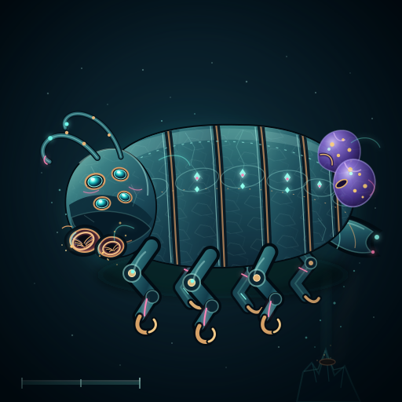
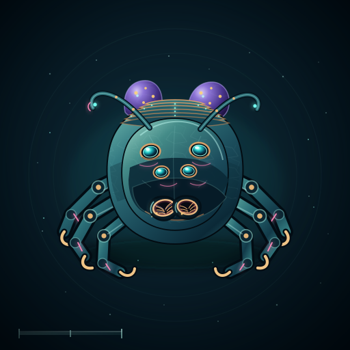
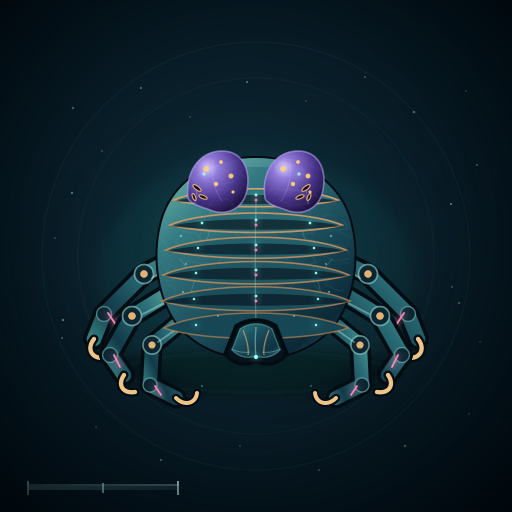
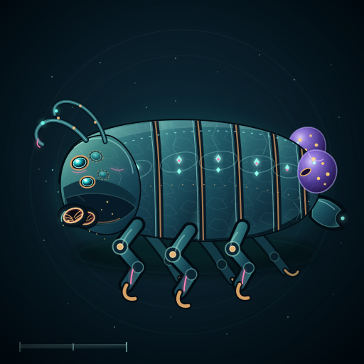
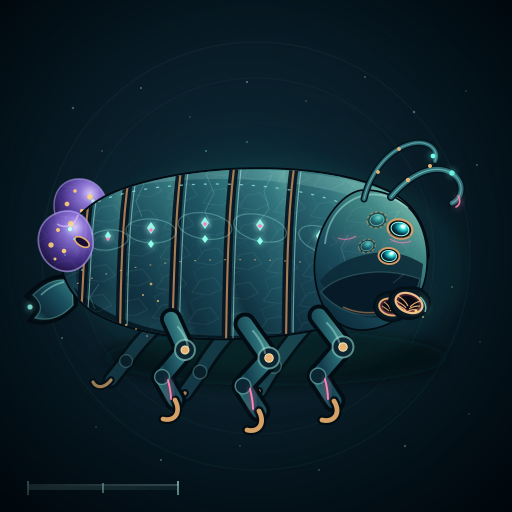
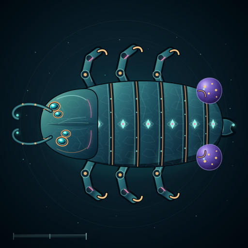
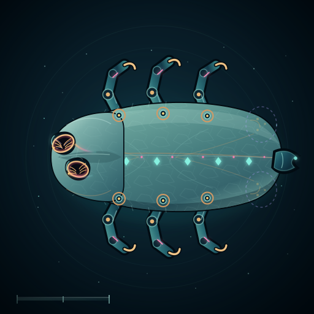
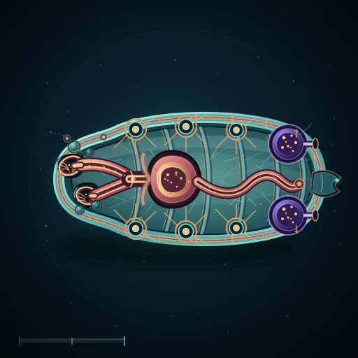
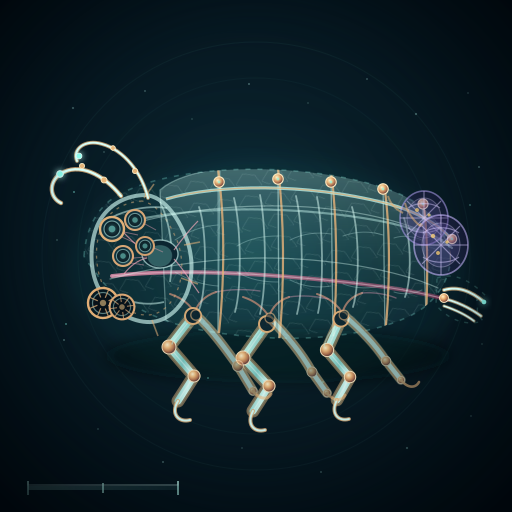
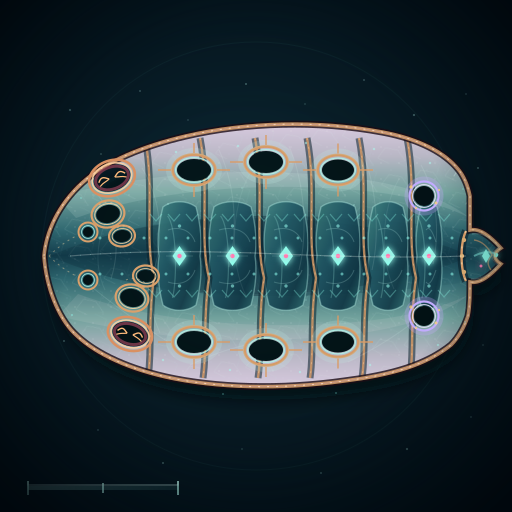

# XenoDesign — K-6

## L0 — K-6, full body (3/4 side)

File: [L0/creature.svg](L0/creature.svg)

---

### L0 design note — shared ledger for all levels

P1 -> 2.6 m snout-to-tail; 1 m bar, two 0.5 m segments, in each image.  
P2 -> vitreous opal cuticle, silica spicules, mineralized seams.  
F1 -> hydrothermal vent chimney and mineral plume at L0 lower right; vent-field palette throughout.  
F2 -> two combed oral siphons and spore intake; section shows both ducts joining one stomach.  
F3 -> cyan/magenta photophore code repeated across all six plates and the midline.  
F4 -> domed six-plate shell over six ventral limb recesses.  
Q1 -> six jointed limbs; far three are darker/ghosted in side views.  
Q2 -> four lensed eyes; far pair dashed in side views, occluded in back and bottom.  
Q3 -> two oral siphons under the cephalon; hidden by the head in top view and absent from back.  
Q4 -> two violet spore sacs at the rear; two pores in the pelt, one ghosted pair in bottom.  
Q5 -> six dorsal plates with five copper seams; hidden above in bottom, six scutes in pelt.  
Q6 -> two segmented antennae; hidden by the head in back and bottom.  
N1 -> mineralized exoskeleton with joint collars, plate hinges and apodemes.

RECONCILE (Q1/F4) -> all six coxae rotate rearward into lateral recesses, each tibia folds 180 degrees under its femur, and each tarsus hooks beneath a plate edge; the limbs stack in paired ventral grooves so the domed shell closes into a ball.  
CONFLICT -> none; six limbs and ball defense coexist by folding, not by reducing parts.  
BONUS -> non-humanoid; non-soft; non-earth; non-tentacle-face.

## L1 — six orthographic views

| front | back | left |
|:--:|:--:|:--:|
|  |  |  |
| **right** | **top** | **bottom** |
|  |  |  |

Files: [front.svg](L1/front.svg) · [back.svg](L1/back.svg) · [left.svg](L1/left.svg) · [right.svg](L1/right.svg) · [top.svg](L1/top.svg) · [bottom.svg](L1/bottom.svg)

---

### L1 design note

Six orthographic views; 150 px/m, centered, no perspective. Hidden: front tail; back 4 eyes, 2 siphons, 2 antennae; side far eyes/limbs; top 2 siphons; bottom 4 eyes, 2 antennae, 6 plates, dashed sacs. Counts: Q1 6, Q2 4, Q3 2, Q4 2, Q5 6, Q6 2. Source: L0 K-6. RECONCILE -> same fold as L0.

## L2 — horizontal mid-body section

File: [L2/section.svg](L2/section.svg)

---

### L2 design note

Horizontal mid-body section; cuticle layers, silica spicules and six plate ribs shown. Two siphons feed two ducts that meet at a Y into one shared stomach, then a blind resorptive hindgut; two spore sacs sit in the lateral wall, each with its own external pore. Hidden: F3 surface photophores and F1 vent omitted; four eye capsules and two antenna roots ghosted above the cut plane. Source: L0 K-6. RECONCILE -> same fold as L0.

## L3 — skeleton + pelt

**Skeleton**

**Pelt**

Files: [skeleton.svg](L3/skeleton.svg) · [pelt.svg](L3/pelt.svg)

---

### L3 design note

Skeleton: opal-silica frame with faint exterior outline, six plate ribs and hinges, six aligned limb cores, four orbital rings, two siphon rings, two sac cages, two antenna cores, tail fan. Pelt: upper half is the left flank, lower half the right flank; central band is dorsal, pale outer fringes are ventral. PELT: one continuous flat sheet; seams = continuous ventral incision, non-incised dorsal midline, five transverse plate seams, tail-base ring; holes = 4 eyes, 2 feeding openings, 6 limb sockets, 2 spore-sac pores, 2 antenna sockets; tail base is a continuous extension, not a hole; no cutaway. Hidden: F1 vent absent; F2/F3 carried by pelt holes/photophores. Source: L0 K-6. RECONCILE -> same fold as L0.
