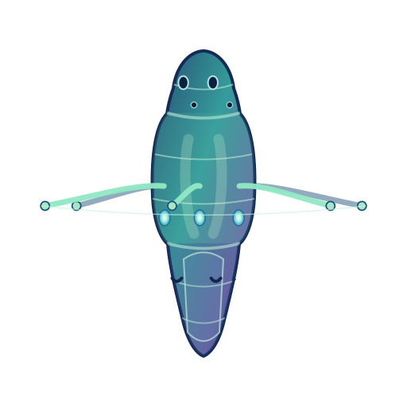
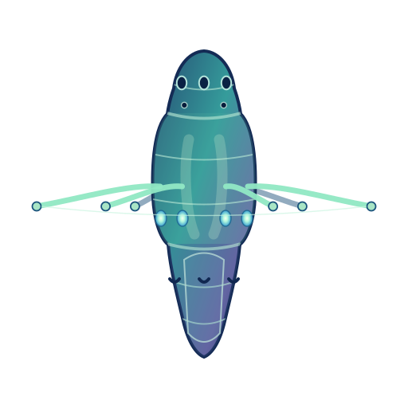
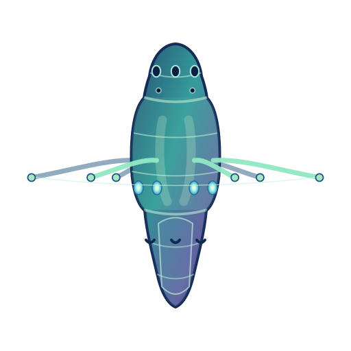
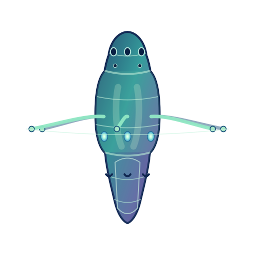
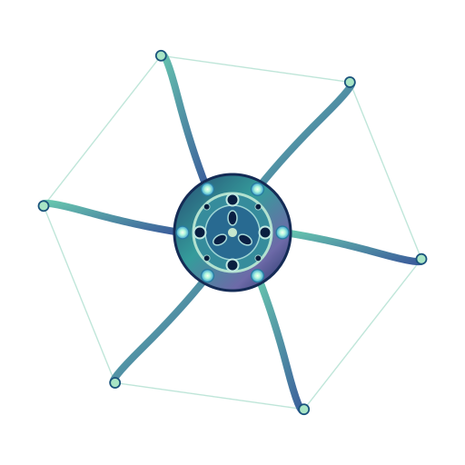
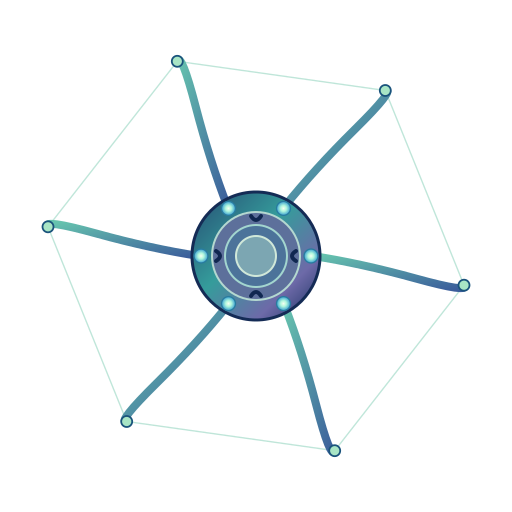

# XenoDesign creature: cyst-weaver-24m

## L0 — full body

---

P1 -> The axial body is 24 m long, from the anterior crown to the posterior tip.  
P2 -> Pale translucent lacunae represent ammonia-rich circulating fluid.  
P3 -> A continuous sealed cuticle covers the body and limbs.  
F1 -> The broad thorax and six radial limbs provide a drifting profile.  
F2 -> Three filter-feeding openings are on the anterior pole, hidden in this view.  
F3 -> Six light organs encircle the thorax; three are hidden behind it.  
F4 -> A folding cyst sheath outlines the posterior abdomen.  
F5 -> Teal and violet cuticle bands show the color-changing surface.  
F6 -> A filament trap spans the limb tips.  
Q1 -> Six limbs attach around one thoracic ring; overlapping limbs remain present.  
Q2 -> Four eyes encircle the crown; two are hidden behind it.  
Q3 -> Three feeding openings are hidden on the anterior pole.  
Q4 -> Four gill openings encircle the abdomen; two are hidden behind it.  
Q5 -> Six light organs encircle the thorax; three are hidden behind it.  
Q6 -> Four sensory pits encircle the crown; two are hidden behind it.  
Q7 -> Seven transverse seams divide the body into eight segments.  
Q8 -> Two broad boundaries divide those segments into crown, thorax, and abdomen sections.  
Q9 -> The appendages are narrow limbs; there are no wings.  
N1 -> The body and its organ rings are arranged around one longitudinal radial axis.  
N2 -> Broad fluid lacunae depict an open circulatory space.  
RECONCILE -> Six limbs and six lights occupy sixfold rings; four eyes and four pits occupy separate fourfold rings. Three sections group eight repeated segments: two crown, three thorax, and three abdomen.  
CONFLICT -> Sixfold, fourfold, and threefold organ counts prevent exact whole-body rotational symmetry. N1 is expressed as a radial body plan.

## L1 — orthographic views

| Front | Back |
|---|---|
|  |  |

| Left | Right |
|---|---|
|  |  |

| Top | Bottom |
|---|---|
|  |  |

---

Source: L0 `cyst-weaver-24m`.  
P1 -> The elevations retain the same 24 m axial length and scale; axial views look along that length.  
P2 -> Translucent ammonia-rich lacunae appear in the elevations and are hidden by the cuticle in axial views.  
P3 -> The sealed cuticle is continuous in every projection.  
F1 -> The thorax and radial limb span appear in every view.  
F2 -> Three anterior filter openings appear in the top view and are occluded elsewhere.  
F3 -> Six thoracic light organs appear together in the axial views; far-side organs are occluded in elevations.  
F4 -> The posterior cyst sheath appears in elevations and as nested rings in the bottom view.  
F5 -> Teal and violet cuticle regions retain the same placement across views.  
F6 -> The six limb tips support one filament trap ring, clearest in axial views.  
Q1 -> Six limbs occupy the same thoracic ring in every SVG; some overlap in elevations.  
Q2 -> Four crown eyes are clear in the top view; far-side eyes are occluded in elevations and all are occluded below.  
Q3 -> Three anterior feeding openings are clear in the top view and occluded in the other views.  
Q4 -> Four abdominal gill openings are clear in the bottom view; far-side openings are occluded in elevations and all are occluded above.  
Q5 -> Six light organs occupy the thoracic ring in every view; far-side organs are occluded in elevations.  
Q6 -> Four crown sensory pits are clear in the top view and occluded where the crown blocks them.  
Q7 -> Seven seams mark eight axial segments in elevations; the segments overlap along the line of sight in axial views.  
Q8 -> Two major boundaries mark three sections in elevations; the sections overlap in axial views.  
Q9 -> Every projecting appendage is a narrow limb, with no wings.  
N1 -> All views share one longitudinal radial axis and the same concentric organ rings.  
N2 -> Paired broad lacunae are visible in elevations and occluded in axial views.  
RECONCILE -> Six limbs and six lights use sixfold rings; four eyes and four pits use separate fourfold rings. The three crown, thorax, and abdomen sections contain two, three, and three repeated segments.  
CONFLICT -> The sixfold, fourfold, and threefold counts prevent exact whole-body rotational symmetry; the radial body plan preserves N1 as far as those counts allow.
